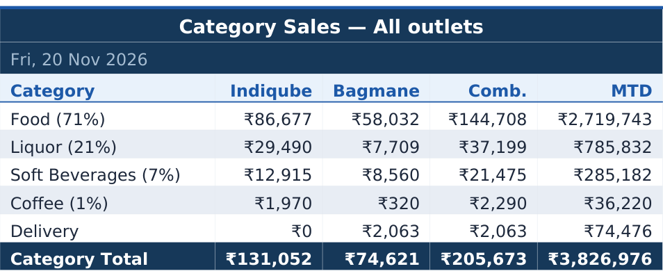
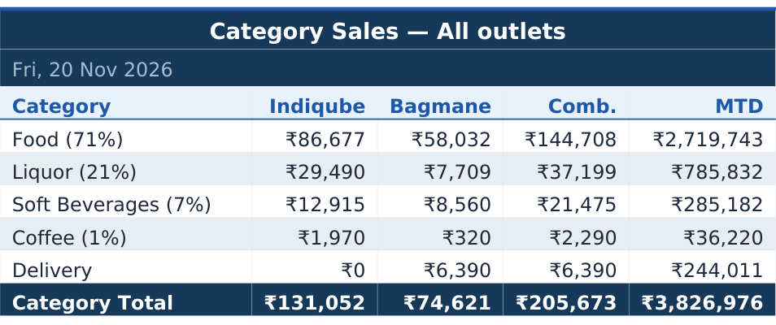

# Delivery sales correction — 21 November 2026

## Evidence and exact cause

Investigated GitHub `main` at `fd0f81e` and read the BotecoMasterDashboard
Supabase project `qhuyklkussmzopahtpri` without writing to production.
Latest imported business date: **20 November 2026**. The November fixture
contains the actual 40 outlet-days from `daily_summary`, joined to separately
aggregated `payment_method_sales` rows by **location_id + date**.

The delivery predicate only matched the word `delivery`. It missed the distinct
`Swiggy` and `Ownly` tenders. A nonzero stored `delivery_sales` prevented the daily
report from reconsidering those tenders, and MTD only summed stored summaries.
Date/outlet filtering was correct. No bill-item join or status filter caused
this mismatch; the item rows supply meal periods, not delivery channels.

| 1–20 November 2026 | Indiqube | Bagmane | Combined |
| --- | ---: | ---: | ---: |
| Previous Delivery | 0 | 74,476 | 74,476 |
| Zomato Delivery | 0 | 74,476 | 74,476 |
| Swiggy | 0 | 164,577 | 164,577 |
| Ownly | 0 | 4,958 | 4,958 |
| Corrected Delivery | 0 | **244,011** | **244,011** |
| POS dine-in | 2,633,408 | 1,441,396 | 4,074,804 |
| POS gross sales | 2,633,408 | 1,685,407 | 4,318,815 |

Pickup and menu-QR totals are zero for this selection. On **all 40 outlet-days**,
corrected Delivery + dine-in + pickup + menu-QR equals POS gross sales.
Fixed and dynamic payment totals separately reconcile to gross with **zero
difference** on each day. Delivery retains the existing **gross/channel** basis;
product categories use item net amounts and are not expected to equal gross.

Bagmane also reconciles daily throughout September (164,443 → 208,721) and
October (125,072 → 273,739; 30 imported dates). No missing dates are filled in.
Older source conflicts exist: four August–October Indiqube dates contain a bare
Swiggy tender although POS assigns all sales to dine-in; two August Bagmane
dates have inconsistent summary/tender classifications. The reconciliation
guard preserves existing results for those conflicts instead of guessing.
Generic historical `Zomato` is also left unclassified.

## Changes

- `services/payment_mapping.py`: recognise exact Swiggy/Ownly names or keys,
  excluding Swiggy Dineout, Zomato District, generic Zomato and other dine-in
  tenders. Share one daily delivery resolver. When POS channel metadata
  contradicts the candidate, retain the previous result. Otherwise use the
  larger of the stored order total and tender total, never their sum.
- `uploads/parsers/growth_report_day_wise.py`: apply that resolver to new imports.
- `services/report_service.py`: fetch existing payment rows for the identical
  MTD range/outlets, resolve each outlet-day, then sum. Existing imports require
  no reupload or database rewrite. Other service/category values are preserved.
- `sheet_reports.py`: use the same resolver and sum resolved outlet columns for
  combined Daily. Delivery stays outside Category Total and category shares.
- Tests and snapshot: cover mapping, contradictory historical sources, new
  imports, range arguments, mixed source coverage, missing summary rows,
  outlet/combined totals and exact November daily-to-MTD reconciliation.
- `tests/test_report_service.py`: mock the added payment read so unit tests
  do not access a configured live database.

## Validation and visual QA

133 focused tests passed in a clean checkout of the latest main plus this fix:

```text
python -m pytest tests/test_delivery_sales.py tests/test_growth_item_import.py tests/test_sheet_reports_formatting.py tests/test_report_service.py tests/test_cache_invalidation.py tests/test_sheet_reports_sections.py -q --tb=short
```

Ruff `E,F,I,B` passed for every touched Python file; `git diff --check` passed.
The full test suite was not run. Existing unrelated local edits were excluded
from both the validation checkout and the commit.

Relevant checks from `docs/visual_qa_checklist.md`:

- [x] Rendered and visually inspected the affected report table before/after
  using actual 20 November categories and November MTD data.
- [x] Headers, amounts, rupee glyphs, row bands and total remain readable and
  unclipped; all product-category amounts and percentages are unchanged.
- [x] Combined Daily equals the displayed outlet amounts: 0 + 6,390 = 6,390.
- [x] MTD shows 244,011, and Category Total remains 3,826,976.
- Other app screens, navigation, controls, chart styles and responsive layouts
  are unaffected; no interactive Streamlit/browser QA was performed.

| Before | After |
| --- | --- |
|  |  |

Prepared as a GitHub change for review; no production data migration or app
deployment is part of this correction. Restart/redeploy the app with the fix
to clear its in-process report caches.
